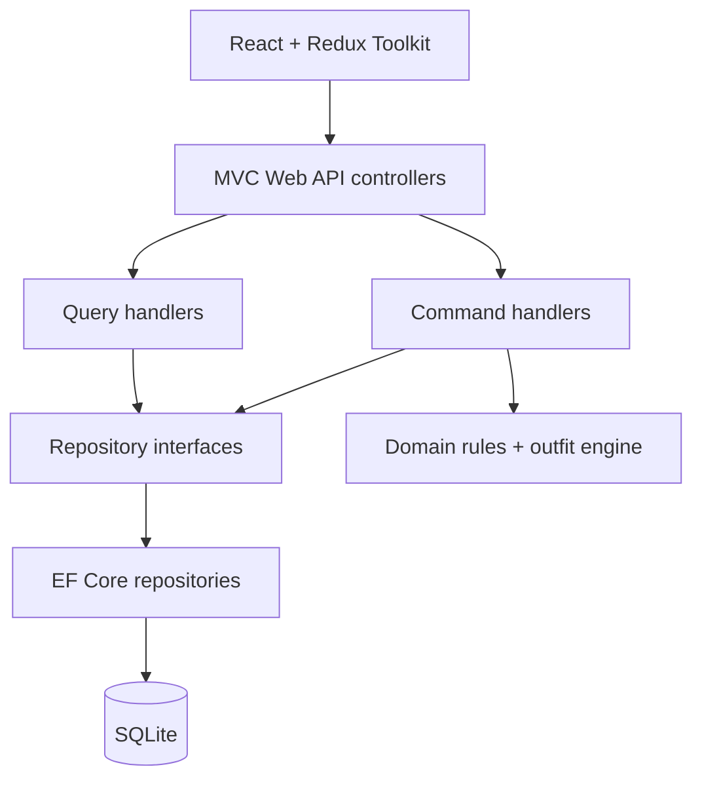

# Thread — your wardrobe, considered

A complete course MVP for organizing clothes, discovering outfits and keeping good pieces in circulation. The backend is **C# / ASP.NET Core 10**, with MVC API controllers, separate CQRS handlers, repositories and an EF Core **SQLite** database. The frontend is **React 19 + TypeScript + Redux Toolkit / RTK Query**.

Course checkpoint: see [COURSE_STAGE.md](COURSE_STAGE.md) for this stage and its verification steps.

## Start here

Install the [.NET 10 SDK](https://dotnet.microsoft.com/download/dotnet/10.0) and [Node.js 24](https://nodejs.org/). From the repository root:

```sh
npm ci --prefix client
npm run dev
```

Open **http://localhost:3000**. The command builds React, copies its assets to the API, builds C#, applies the included database migration and starts one same-origin website. First startup can take a minute. Click **Explore the demo**.

Alternatively, with Docker Desktop:

```sh
docker compose up --build
```

The supplied Compose configuration is explicitly a **local development demo**. It preserves the SQLite database and encryption keys in a named Docker volume. Do not expose this demo configuration to the public internet.

## What works

| Area            | MVP behavior                                                                                                                                                                                                       |
| --------------- | ------------------------------------------------------------------------------------------------------------------------------------------------------------------------------------------------------------------ |
| Wardrobe        | Add, edit, delete and favorite garments; mark unavailable; organize clothes and shoes; combine search, category, color, season, style, era and favorite filters; sort by date/name/color.                          |
| Outfit studio   | Generate up to three explainable combinations from available owned pieces; choose season, era, style and palette; use curated style edits; save named looks.                                                       |
| Sharing         | Create a random public outfit URL; copy it, use native sharing, Facebook or Pinterest; revoke the URL. Other wardrobe items and email addresses are not exposed.                                                   |
| Community store | Create sell, lend or giveaway listings, browse/search/filter, withdraw available listings and request a single-item reservation.                                                                                   |
| Reservations    | Buyer requests/cancels; seller accepts/declines/completes. Conditional database updates prevent double reservations. Cancellation/decline releases stock; completing a loan marks it returned and available again. |
| Accounts        | Register, activate email, resend activation, sign in/out, reset/change password, edit profile. Google and Facebook OAuth adapters are included and activate only after server credentials are configured.          |
| User experience | Responsive layouts, loading/disabled states, accessible form labels, keyboard navigation, modal focus management, error messages and confirmations.                                                                |

### Honest boundaries

- The store coordinates **local reservations**. No card charges, shipping, refunds, seller payouts or private chat are implemented. Prices are displayed in USD. Put handover details in the reservation message.
- Trends are **editor-curated inspiration**, not a live fashion feed or an AI claim. The score is a deterministic ranking, not confidence or a promise of taste.
- An outfit has one top, one bottom and one pair of shoes. Layers/accessories can be catalogued; automatic layering is a later iteration.
- Images are selected from 11 bundled, openly licensed examples. Personal uploads, background removal and image recognition are outside this MVP.
- Google/Facebook accounts and real email delivery need your provider credentials. They were not end-to-end verified against live provider accounts. Disabled buttons explain that setup requirement.
- SQLite is local, relational and persistent; it has no database subscription fee. This repository does not claim that a production host or managed SQL tier is free.
- This is a single-instance MVP. Add moderation, privacy/account deletion, backups, observability and operational review before a public commercial launch.

## Demo accounts

In **Development** with `Demo:Enabled=true` only:

| Role                   | Email               | Password            |
| ---------------------- | ------------------- | ------------------- |
| Wardrobe owner / buyer | `alex@example.test` | `Thread-Demo-2026!` |
| Seller                 | `maya@example.test` | `Thread-Demo-2026!` |

The profile dialog includes **Switch demo role** so you can request a piece as Alex and accept it as Maya. These are deliberately public sample credentials, not secrets. Production ignores demo mode even if the flag is accidentally enabled. Use a **fresh production database**, never one copied from a development demo.

When SMTP is absent in Development demo mode, registration/recovery displays a clearly labeled test link instead of sending email. Production never returns these links.

## Architecture



| Project                   | Responsibility                                                                                       |
| ------------------------- | ---------------------------------------------------------------------------------------------------- |
| `Wardrobe.Domain`         | Entities, controlled vocabularies and pure outfit rules. No infrastructure references.               |
| `Wardrobe.Application`    | CQRS request types, read/write handlers, DTOs, repository and unit-of-work contracts.                |
| `Wardrobe.Infrastructure` | EF Core, Identity persistence, migrations, repositories, reservation transactions and demo seed.     |
| `Wardrobe.Api`            | HTTP controllers, cookie authentication, CSRF, OAuth, SMTP, rate limits, DI and static React assets. |
| `client`                  | React components, shared UI, Redux UI slice and RTK Query data cache.                                |

CQRS here means separate **command and query paths**, sharing one database. It does not require an event bus, MediatR, event sourcing or separate read replicas. MVC controllers return JSON; React supplies the view layer.

## Learn, configure, deploy

- [Build it step by step](docs/BUILD_GUIDE.md)
- [Blue design system and desktop/mobile screenshots](docs/DESIGN_SYSTEM.md)
- [MVP scope and acceptance criteria](docs/MVP.md)
- [Provider configuration and deployment](docs/DEPLOYMENT.md)
- [HTTP API reference](docs/API.md)
- [Walkthrough and implementation notes](docs/DEMO_WALKTHROUGH.md)
- [Photo sources and licenses](client/public/image-credits.json)

## Validate

```sh
dotnet test Wardrobe.sln -m:1 -p:UseSharedCompilation=false
npm --prefix client test
npm --prefix client run build
npm audit --prefix client --audit-level=moderate
dotnet package list --vulnerable --include-transitive
```

GitHub Actions builds, tests and packages the application. The optional **Publish container** workflow publishes a Docker image to your repository's GitHub Container Registry when you run it manually. Nothing in this repository provisions a paid service automatically.

Source code uses the repository's existing MIT license. Photo-specific CC0 records are bundled separately. Manrope is bundled under the SIL Open Font License in `client/public/fonts/OFL-Manrope.txt`. Trademarks in sample photos imply no endorsement.
