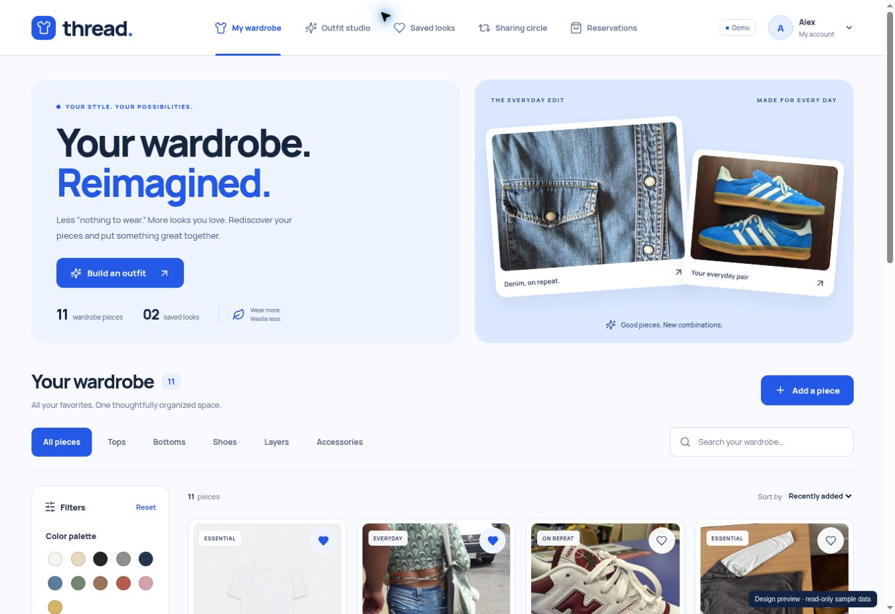
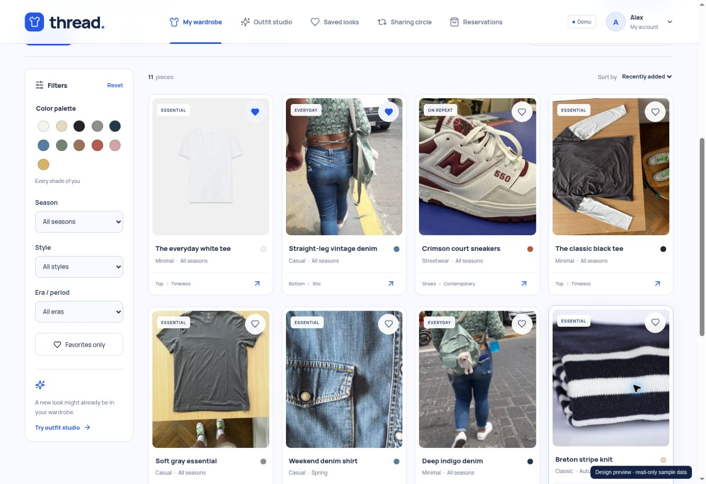
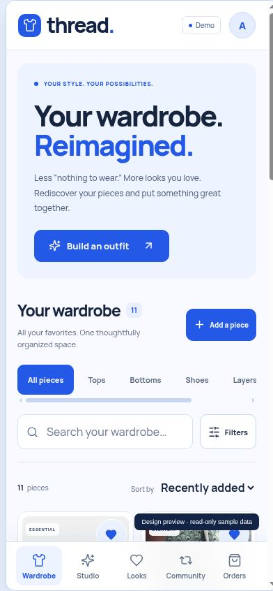

# Thread blue design system

Thread uses a cobalt-blue identity, pale blue surfaces, clear typography and a photo-led catalog. The layout helps users browse their wardrobe, narrow a selection and build a look without losing access to the main sections.

## Foundations

The shared tokens live at the top of `client/src/styles.css`. Use these tokens when adding screens so account, wardrobe, outfit and community flows stay visually consistent.

| Role | Value | Use |
| --- | --- | --- |
| Primary | `#2458e7` | Primary actions, active navigation, selected filters and links |
| Primary hover | `#1844bf` | Hovered primary actions |
| Text | `#17243e` | Headings, labels and body copy |
| Muted text | `#62708a` | Supporting copy and metadata |
| Page | `#f8faff` | Main page background |
| Surface | `#ffffff` | Product cards, dialogs and fields |
| Blue wash | `#edf3ff` | Hero, selected controls and supporting panels |
| Border | `#dfe6f1` | Subtle boundaries and dividers |
| Navy | `#122346` | Strong contrasting panels |

Manrope Variable is bundled through `@fontsource-variable/manrope`, with Latin and Cyrillic subsets and `font-display: swap`. There is no runtime font-CDN request. The [SIL Open Font License](../client/public/fonts/OFL-Manrope.txt) is shipped with the app and linked in Photo credits.

Headings use a strong weight and compact tracking. Body text stays restrained; spacing and size establish hierarchy before decoration. Main buttons have a 46 px minimum height. Rounded corners, thin borders and soft shadows distinguish interactive cards without making every element compete for attention.

## Layout and components

- **Desktop shell:** sticky horizontal navigation, a visible account control and an active-section underline. The wardrobe hero pairs a clear action with a denim-and-shoes collage.
- **Catalog:** category buttons above the results; a left filter panel for color, season, style, era and favorites; an independent sort control; and a live result count. Filters remain in Redux when navigating between sections.
- **Product cards:** a consistent photo area, favorite control, name, style/season, color and category/era metadata. Photos use cover cropping in the catalog; the editor and outfit combinations preserve the whole image with contain sizing.
- **Shared flows:** the outfit studio, saved looks, community listings, reservations, account forms, public outfit page and dialogs use the same tokens, buttons and brand component.
- **State feedback:** selected buttons expose `aria-pressed`; the mobile filter toggle exposes `aria-expanded` and `aria-controls`. Existing loading, error, disabled and empty states remain visible.

## Responsive behavior

| Width | Behavior |
| --- | --- |
| Above 1100 px | Desktop navigation and persistent catalog filter panel; grid density adjusts to the available width. |
| 1100 px and below | Filters move into an expandable panel above the results; search gains the available row width. |
| 950 px and below | Five main sections move to a fixed bottom navigation bar; content reserves space for the bar and device safe area. |
| 700 px and below | Two-column catalog, stacked sections, compact hero and larger form text; decorative hero imagery is removed to prioritize the user's wardrobe. |
| 420 px and below | Further spacing adjustments for narrow phones; larger favorite controls and compact card metadata. |

Mobile form inputs use 16 px text. Navigation and filters remain usable with keyboard focus; dialogs retain their focus trap, Escape handling and focus restoration. Motion is reduced when `prefers-reduced-motion` is enabled. The mobile header deliberately avoids `backdrop-filter`, which would otherwise change the containing block for its fixed bottom navigation.

## Verify a design change

1. Run `npm ci --prefix client`, `npm --prefix client test` and `npm --prefix client run build`.
2. Start the complete application using the README and inspect the wardrobe at desktop, tablet and narrow phone widths.
3. Combine the Blue color filter with Tops, clear filters, change sorting and navigate away and back.
4. Expand and collapse mobile filters. Confirm that content remains above the bottom navigation and there is no horizontal page overflow.
5. Open Add a piece; tab through the form, press Escape and confirm focus returns to its trigger.
6. Review the outfit studio, saved looks, community and account pages for the same type, color and spacing rules.

The supplied screenshots were captured from the actual React components with API-exported sample data. Design review covered desktop plus 360, 390 and 768 px preview frames, navigation, combined filtering, mobile filter expansion, dialog dismissal and focus restoration. Scrollbars reduce the inner frame content width slightly. No horizontal page overflow was observed at those sizes.

The interactive design preview was read-only. It validates layout and those UI interactions, not live browser-to-API mutations, OAuth, email or production hosting. The preview badge is review tooling and is absent from the production app. Backend behavior is covered separately by the repository's domain and HTTP integration tests. This review is not a formal accessibility certification.

## Design references

The requested references informed the direction: bold fashion typography, light surfaces, category navigation, a filter rail and image-led cards. Thread has its own components and layout; reference-site assets were not copied. Existing sample photos and their [CC0 source records](../client/public/image-credits.json) remain bundled.

- [Fireart — Designing modern UI/UX](https://fireart.studio/blog/designing-modern-ui-ux/)
- [Pixeto — UI/UX design trends](https://www.pixeto.co/blog/ui-ux-design-trends)
- [Dribbble — UX/UI for online clothing store](https://dribbble.com/shots/25918332-UX-UI-For-Online-Clothing-Store)
- [Dribbble — Streetwear catalog overview, QRQ Marketplace](https://dribbble.com/shots/27547523-Streetwear-Catalog-Overview-QRQ-Marketplace)
